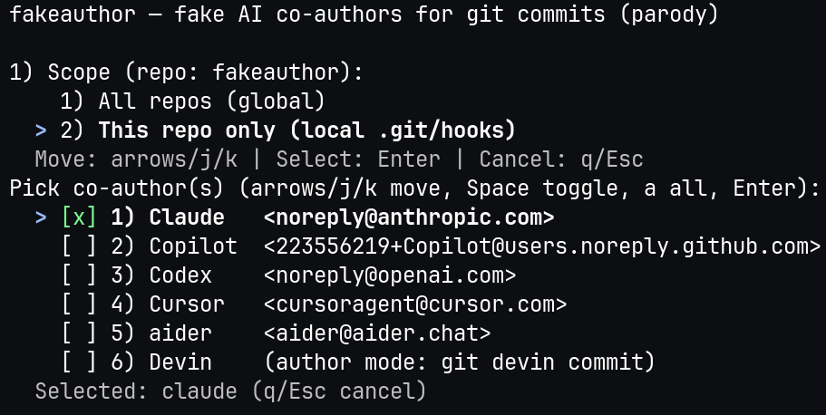

# fakeauthor

Too poor to afford Claude? Want to impress your girl by showing you have 100 commits a day, all with "Co-author: Claude"?
Or maybe your workplace forced you to use Github Copilot but it is so bad you have to use Codex? 

This project will help you adding imaginary co-author (Claude, Codex,...) on your commit.

Supports Linux and Windows (Git for Windows). PRs for macOS are welcome!

<p align="center">
  
</p>


## Install

### Linux / Git Bash

```sh
# Interactive picker
curl -fsSL https://raw.githubusercontent.com/segfawlt/fakeauthor/refs/heads/main/install.sh | sh
```

### Windows (PowerShell)

Requires [Git for Windows](https://git-scm.com/download/win).

```powershell
# Interactive picker
irm https://raw.githubusercontent.com/segfawlt/fakeauthor/refs/heads/main/install.ps1 | iex
```

Global installs live in `~/.local/share/fakeauthor/` and chain existing repo
hooks without clobbering them. `--local` installs inside `.git/` only.

## Usage

Once installed, you never need `curl` again. Run `git fakeauthor` anytime to
re-open the menu and modify co-authors or scope:

```sh
git fakeauthor            # open the interactive menu to modify co-authors/scope
git fakeauthor off        # pause in this repo (or globally outside a repo)
git fakeauthor on         # resume in this repo (or globally outside a repo)
git fakeauthor status     # show active state, version, personas, rate, and aliases
git fakeauthor update     # check for updates and update/repair install
git fakeauthor update --check # check for updates without modifying files
git fakeauthor uninstall  # exact manifest-verified removal
git devin commit -m "hi"  # author mode (also works as git claude, git codex, ...)
```

## Presets & Config

Presets: `claude`, `copilot`, `codex`, `cursor`, `aider`, `devin` (author mode
only). Tune anytime via `git config` without reinstalling:

```sh
git config fakeauthor.persona claude,codex
git config --global fakeauthor.rate 0.25               # chaos mode (25% of commits)
NO_FAKEAUTHOR=1 git commit -m "honest"                 # skip one commit (sh/bash)
git -c fakeauthor.off=true commit -m "honest"          # skip one commit (cross-shell / PowerShell)
```

## Known Limits

- Python `pre-commit install` refuses global `core.hooksPath` — use `--local` in
  those repos.
- GUI git clients that skip hooks and `git commit --no-verify` bypass `commit-msg`.
- Interactive `git rebase` (`reword`/`edit`) runs `commit-msg` on rewritten commits.

## License

GPL 3.0 
